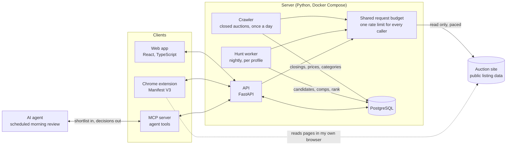
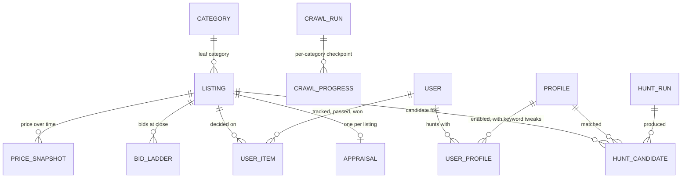

# Hammerpick

Hammerpick finds underpriced auctions on an online auction site and tells me
what they are worth before I bid. I built it for
myself in September 2026 and have used it every morning since. It is now in a
private beta.

This repository is a showcase: what the product does, how it is put together,
and the parts I think are worth an engineer's time. The production code is in
a private repository.

## What it is

Three pieces run on a 24-hour loop.

- **A crawler** reads every auction that closed the previous day and stores it
  in PostgreSQL. That is roughly 100,000 listings a day: 93,000 on average
  over the first twelve logged runs, and about 115,000 on the busiest day I
  measured. It is rate limited, identifies itself, and reads public data
  only. It uses about 90% fewer requests than the obvious design (see below).
- **A nightly hunt** searches live listings for each of my hunt profiles
  (watches, cameras, vintage audio and so on), drops the junk, prices each
  survivor against comparable closed auctions from the crawler's data, and
  ranks what is left against my own history of tracks, passes and wins.
- **A web app and a Chrome extension** put the result in front of me. The web
  app shows the morning shortlist with an appraisal and a suggested ceiling
  for each pick. The extension adds a Track control and the appraisal to the
  auction site's own listing pages, and reports back which auctions I won.

An AI agent sits in the loop too. It reads the overnight shortlist through an
MCP server, judges each candidate, and writes its recommendations back.

Hammerpick never bids and never logs in to the auction site. I place my own
bids.

## Screenshots

_Screenshots are being prepared and will be added here._

## Architecture

What PostgreSQL holds, at a high level:

`LISTING` is shared by everyone: one row per auction the system has ever
seen, whether the crawler, the hunt or a user found it. Everything personal
(status, stars, ceiling, notes, pass reasons, outcome) lives in `USER_ITEM`,
so the market data never had to be split when the product went from one user
to many.

## What makes it interesting technically

### Recording every closing with about 90% fewer requests

Appraisals need comparable sales, and the auction site only shows closed
auctions for a short time. History has to be collected as it happens or it is
gone.

Before writing the crawler I measured the problem. A count-only pass found
about 115,000 closings in one day. Fetching the detail page for each one,
which is the obvious design, would take about 235,000 requests a day.

The crawler does three things instead:

1. **It reads closings from category result pages**, which return dozens of
   listings per request, and treats that as the record: title, final price,
   bid count, end time, seller, category. The logged daily runs take between
   3,700 and 6,600 requests to cover everything.
2. **It fetches detail only where detail earns its cost.** The categories my
   hunt profiles draw on each have a price floor, set from the crawler's own
   closing data. A $4 shirt is never a useful comparable, so it never costs
   a second request. A $40 camera lens does. The detail pass is budgeted at
   about 11,000 requests a day.
3. **It never repeats work.** Progress is checkpointed per category and per
   page, so a restart or a power cut resumes at the exact page it stopped on.

That puts a full day at roughly 15,000 to 18,000 requests against 235,000,
about one request every five seconds averaged over the day.

How the crawler behaves matters as much as how many requests it makes:

- Every component that talks to the site draws from one shared budget held in
  PostgreSQL, so separate processes cannot add up to a burst.
- Interactive requests get priority over batch work. A person waiting on a
  page never queues behind the crawler.
- It backs off when asked to, and a circuit breaker pauses every caller at
  once if the site starts refusing requests. Tuning that breaker was its own
  lesson: the first rule tripped on a few stray errors and emptied two
  mornings of picks, so it now distinguishes noise from a real refusal by
  what share of responses are failing.
- It identifies itself honestly, reads closed auctions once a day, and stores
  image links, never the images.
- Completeness is checked per category after every run, and a short category
  is reported by name. That check caught a bug where the site repeated a page
  under load and the crawler took it for the end of a category.

### The hunt-profile scoring model

A hunt profile is a category, a set of search phrases, an exclusion list and
a price floor. Each night, for each profile:

1. **Search and filter.** Run the profile's searches against live listings,
   then drop exclusions (a strategy guide in the video games profile),
   anything ending too soon to act on, and anything under the floor.
2. **Price it against real sales.** Find closed auctions from the last 90
   days whose titles share enough significant words with the candidate, in
   the same categories, and take the median closing price.
3. **Compute a deal signal.** The base-2 log of median over current price,
   clamped, so a listing at half its comparable median scores one point and
   a wild outlier cannot dominate. A listing with no bids yet gets a small
   bonus.
4. **Add taste, per user and per profile.** Every decision I make becomes a
   weight on the words in that listing's title. A win counts most, then a
   track, with stars adding to either. Passes count against, scaled by the
   reason: "not my taste" is a strong signal, "too expensive" barely is one,
   and a one-click pass with no reason counts for almost nothing. A
   candidate's taste score is the mean of its matched word weights.

Three details came from watching the first version fail:

- **Scores are scoped per profile.** One global model ranked jewelry at the
  top of the synthesizer shortlist because I had starred gold clothing.
  Twenty-three of twenty-eight rows one morning were from the wrong category.
- **The score is a mean, not a sum,** so a long title cannot win by piling up
  weak matches.
- **A profile with fewer than three decisions has no model** and says so,
  instead of producing a confident ranking from noise.

The statistical appraisal on each pick is deliberately plain arithmetic over
comparable sales. It is cheap, explainable, and testable against the price
the auction really closed at.

### An AI agent that reviews the shortlist through MCP

Finding a good listing has two halves. Searching is expensive and dumb:
hundreds of results, most of them junk, every one a network call. Judging is
cheap and needs sense: a heuristic cannot read "missing plastic cover plate"
and know it means a cosmetic part.

The first version had the agent do both, and it spent most of its context
window on search results before any judging happened. So I split the loop by
cost. The server does the fan-out overnight and stores a short, enriched
list. A scheduled agent session then reads that list through an MCP server,
decides each candidate, and writes back a recommendation with an appraisal
and a ceiling, or a dismissal with a reason. Those decisions feed the next
night's taste model.

Two things I would point another engineer at:

- **Responses are shaped for a model, not a browser.** Anything true for the
  whole response is stated once at the top, rows are positional under a
  declared column list, and fields the model cannot act on are not sent.
  Context is the scarce resource in an agent loop.
- **The agent only knows what happened if the system tells it.** Early on,
  the agent's notes claimed wins that never happened. The extension now
  reads my real auction outcomes in my own browser and syncs them, and the
  tool descriptions tell the agent to report a win only when the record says
  so.

## Stack

Python 3.12, FastAPI, PostgreSQL 16, Alembic, psycopg. React, TypeScript and
Vite for the web app. A Manifest V3 Chrome extension. An MCP server in
Python. Docker Compose for deployment, GitHub Actions for CI with a Postgres
service, and about 830 server tests.

## License

The contents of this repository are released under the MIT License. See
[LICENSE](LICENSE).
